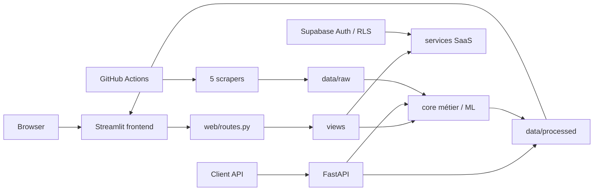

<div align="center">

# 🚗 AutoDeal Tunisie

**Plateforme d'intelligence du marché automobile tunisien : collecte multi-sources, estimation ML, comparables réels, détection d'opportunités, API et monitoring de fiabilité.**


</div>

---

## Objectif

AutoDeal Tunisie répond à une question simple : **une voiture est-elle affichée à un prix cohérent avec le marché, et avec quel niveau de confiance ?**

Le système combine plusieurs signaux indépendants :

- estimation Machine Learning entraînée sur les annonces récentes ;
- valorisation par comparables réels : médiane, Q25–Q75 et P10–P90 ;
- profondeur et homogénéité du marché comparable ;
- détection de décote anormale ;
- garde-fous métier et qualité de données ;
- suivi longitudinal des annonces ;
- monitoring de performance et de drift.

> Les prix collectés sont des **prix demandés**, pas des prix de transaction certifiés. Une annonce disparue est un proxy d'écoulement, pas une preuve de vente.

---

## V2 Architecture

La V2 sépare désormais clairement les responsabilités :



### Responsabilités

| Couche | Rôle |
|---|---|
| `app.py` | point d'entrée Streamlit très léger + router |
| `web/routes.py` | registre canonique des pages et URLs |
| `views/` | présentation Streamlit ; migration progressive des anciennes vues |
| `backend/` | API FastAPI indépendante de Streamlit |
| `core/` | nettoyage, feature engineering, ML, comparables, validation, monitoring |
| `services/` | Supabase, paiements et intégrations applicatives |
| `utils/` | notifications et tâches backend |
| `scrapers/` | collecte multi-sources |

L'ancien dossier `_modularisation/` a été supprimé : il dupliquait une partie de l'application sans être le runtime réel.

### Migration progressive sans régression fonctionnelle

L'ancien `app.py` de grande taille est conservé temporairement dans `views/legacy_dashboard.py`. Le nouvel `app.py` ne contient plus la logique métier des pages : il orchestre la navigation et délègue le rendu.

Cette étape permet de découper ensuite `legacy_dashboard.py` page par page sans réécrire tout le produit en une fois. Le comportement existant reste ainsi conservé pendant la migration.

---

## URLs propres

La navigation utilise maintenant le routeur natif de Streamlit (`st.Page`, `st.navigation`, `st.switch_page`). Chaque page possède une URL stable au lieu de garder la même URL pendant toute la session.

Exemples :

```text
/accueil
/acheter
/comparateur
/marche
/historique
/alertes
/compte
/tarifs
/estimer
/assistant
/pro-samsar
/pro-concessionnaire
/recherche-avancee
/carte
/admin
```

Les anciennes actions internes qui modifient encore `st.session_state["page"]` sont interceptées par une couche de compatibilité et transformées en **vraie navigation URL**. Elles pourront être migrées progressivement vers le nouveau router.

> **Pourquoi FastAPI ne gère pas les onglets Streamlit ?** FastAPI fournit des routes HTTP backend. L'URL visible d'une page Streamlit doit être gérée par le router frontend de Streamlit. AutoDeal utilise donc le bon outil à chaque niveau : Streamlit pour les URLs de pages, FastAPI pour les URLs d'API.

---

## API FastAPI

AutoDeal possède maintenant une API backend read-only versionnée.

### Démarrage local

```bash
uvicorn backend.main:app --reload --port 8000
```

Documentation interactive :

```text
http://127.0.0.1:8000/docs
```

ReDoc :

```text
http://127.0.0.1:8000/redoc
```

### Endpoints

| Méthode | Endpoint | Usage | Clé API* |
|---|---|---|---|
| `GET` | `/health` | santé du service | — |
| `GET` | `/api/v1/market/summary` | résumé du marché | — |
| `GET` | `/api/v1/listings` | recherche filtrée et paginée | si tri par opportunité |
| `GET` | `/api/v1/deals` | opportunités détectées (radar) | oui |
| `POST` | `/api/v1/valuation/comparables` | valorisation indépendante par comparables | — |
| `POST` | `/api/v1/valuation/estimate` | estimation ML + fourchette calibrée à 80 % + contrôle par comparables | — |

\* Seulement si `AUTODEAL_API_KEY` est défini (en-tête `X-API-Key`). Sans variable, l'API reste ouverte (développement).

Exemples :

```bash
curl "http://127.0.0.1:8000/api/v1/listings?brand=Peugeot&model=208&max_price=50000&sort=price_asc&limit=20"

curl -X POST http://127.0.0.1:8000/api/v1/valuation/estimate \
  -H "Content-Type: application/json" \
  -d '{"brand":"Peugeot","model":"208","year":2020,"mileage_km":70000,"fuel":"Essence","gearbox":"Manuelle"}'
```

| Variable | Rôle | Défaut |
|---|---|---|
| `AUTODEAL_API_KEY` | protège le radar de deals | (ouverte) |
| `AUTODEAL_RATE_LIMIT_PER_MIN` | requêtes `/api/*` par IP et par minute (0 = illimité) | `120` |
| `AUTODEAL_CORS_ORIGINS` | origines autorisées | localhost:8501 |

Image Docker de l'API (dépendances minimales, utilisateur non root) : `make docker` puis `docker run -p 8000:8000 -e AUTODEAL_API_KEY=... autodeal-api`.

La première version de l'API est volontairement **read-only**. Les opérations sensibles liées aux comptes, abonnements et paiements restent protégées par Supabase/RLS jusqu'à l'introduction d'endpoints authentifiés dédiés.

CORS se configure avec :

```text
AUTODEAL_CORS_ORIGINS=http://localhost:8501,https://votre-frontend.example
```

---

## Fonctionnalités produit

### Acheteur

- recherche et filtrage ;
- estimation d'un véhicule ;
- comparaison de plusieurs annonces ;
- historique et santé du marché ;
- favoris et alertes persistants ;
- score AutoDeal ;
- score de confiance distinct du score d'opportunité.

### Samsar

- opportunités et gain potentiel ;
- ROI estimé ;
- profondeur du marché ;
- fenêtre d'achat ;
- arbitrage géographique ;
- accès conditionné au rôle et à l'abonnement.

### Concessionnaire

- structure du marché ;
- courbes de dépréciation corrigées de la composition ;
- niveaux de prix ;
- prime professionnelle ;
- analyses de parc.

### Admin / ML

- benchmark de modèles ;
- validation out-of-fold ;
- GroupKFold marque-modèle ;
- holdout temporel ;
- source holdout ;
- MdAPE, MdAE, MAE et P90 ;
- couverture ±5 %, ±10 %, ±15 % ;
- biais signé ;
- SHAP ;
- drift du prix, du volume et du mix de sources ;
- qualité du scraping.

---

## Sources

| Source | Statut | Particularité |
|---|---|---|
| `automobile.tn` | principale | volume important, structurée |
| `tayara.tn` | principale | petites annonces, gros volume |
| `automax.tn` | principale | source automobile directe |
| `sayyaratn.com` | optionnelle | rendu JavaScript |
| `autocentral.tn` | optionnelle | agrégateur ; provenances inédites uniquement |

La fusion finale déduplique également les annonces par lien.

---

## Pipeline Data / ML

```text
scrapers/*
  ↓
core/merging_files.py
  ↓
core/nettoyer_base.py
  ↓
core/enrichir_base_avance.py
  ↓
core/modele_prediction.py
  ↓
core/detect_deals.py
  ↓
core/suivi_annonces.py
```

`main.py` orchestre le pipeline. GitHub Actions ajoute le quality gate, le suivi de performance, les notifications et la publication des données validées.

Points clés du traitement :

- **Catalogue du jour** : chaque scraper publie les liens réellement vus sur ses pages de liste (`data/raw/vus/`, résumé dans `pipeline_run.json`), marqués complets ou partiels. Les CSV bruts étant cumulatifs, c'est la seule source fiable pour savoir ce qui est encore en ligne.
- **Prix actuel** : le prix affiché aujourd'hui (ou le dernier prix du suivi) remplace le premier prix figé dans les CSV bruts ; `Prix_Initial`, `Variation_Prix_Pct` et `Baisse_Prix` sont conservés.
- **Republications** : une même voiture republiée ou recopiée sur un autre site ne compte qu'une fois (clé marque/modèle/année/km/prix/énergie/boîte) ; `Nb_Publications` est gardé comme signal de négociation. Les annonces tayara sont identifiées par leur ID, indépendamment de la ville dans l'URL.
- **Dates** : toutes les dates métier sont à l'heure de Tunis (`core/dates.py`).

### Modèle de prix

La cible est `log1p(Prix)`. Les prix publiés dans le jeu scoré sont calculés **out-of-fold** : une annonce n'est jamais évaluée par un modèle qui l'a utilisée pour son entraînement.

Candidats actuels : Ridge, RandomForest, HistGradientBoosting, CatBoost, LightGBM et XGBoost.

Features numériques de production :

```text
Kilométrage
Log_Kilometrage
Age_Vehicule
Age_Carre
Km_Par_An
Puissance_Fiscale
Cylindree
Segment_Vehicule
```

Features catégorielles :

```text
Marque
Modèle
Energie
Boite_Vitesse
```

`Zone_Economique` reste hors du modèle de prix à cause de son confounding avec la provenance des annonces.

### Dernier diagnostic versionné

Run du 27 octobre 2026 (3 469 annonces, 3 009 véhicules distincts), validation
croisée **groupée par véhicule** : une même voiture publiée sur deux sites (ou
republiée) reste dans un seul fold. Les chiffres antérieurs, calculés en KFold
aléatoire, étaient optimistes d'environ 1,5 point à cause de ces doublons.

| Test | MdAPE |
|---|---:|
| CV out-of-fold groupée (HistGradientBoosting retenu) | **9,34 %** |
| Holdout temporel ~20 % (coupé sur une date, doublons retirés) | **9,69 %** |
| GroupKFold marque-modèle (stress-test) | **15,82 %** |

**9,3 % de MdAPE ne signifie pas 90,7 % de précision.** Il s'agit de l'erreur absolue relative médiane dans ce protocole.

**Sélection du modèle** (`choisir_modele`). Les deux meilleurs candidats en CV sont départagés ainsi :

1. critère principal : **erreur de production** = moyenne de 5 CV groupées (seeds différentes) + 3 holdouts temporels — c'est le scénario réel (nouvelles annonces de marques et de sources connues) ;
2. garde-fou : un candidat est écarté si son **erreur aux stress-tests** (marques-modèles jamais vus + sources exclues, moyenne pondérée par volume) dépasse celle du meilleur de plus de 15 % ;
3. quasi ex-aequo en production (écart < bruit mesuré) : le meilleur aux stress-tests l'emporte.

L'ancienne règle donnait deux tiers du poids aux stress-tests et faisait alterner HistGradientBoosting et XGBoost d'une nuit à l'autre.

**Fourchettes de prix calibrées** (`core/intervalles.py`). Les fourchettes affichées sont des intervalles à 80 % appris sur les erreurs hors échantillon du modèle, par tranche de prix (plus larges en haut de gamme). Leur couverture réelle est mesurée sur les annonces les plus récentes et publiée dans `diagnostics_modele.json` (≈ 83 % pour 80 % visés au 27/10/2026). L'ancienne fourchette « ± erreur médiane » ne contenait le vrai prix qu'environ une fois sur deux.

Le source-holdout d'`autocentral.tn (facebook)` reste très difficile (~52 %) : la source est en quarantaine pour les alertes automatiques.

---

## Comparables indépendants

`core/market_valuation.py` construit un voisinage réel sans utiliser `Prix_Theorique` :

- même marque et modèle ;
- âge proche ;
- kilométrage proche ;
- énergie contrôlée quand disponible ;
- boîte contrôlée lorsque l'échantillon reste suffisant.

Il retourne notamment :

- nombre de comparables ;
- médiane ;
- P10 / P90 ;
- Q25 / Q75 ;
- largeur relative ;
- homogénéité ;
- niveau de confiance.

Cela permet de confronter **ML Valuation** et **Market Comparable Valuation** sans circularité.

---

## Quality gate et monitoring

`core/quality_gate.py` contrôle avant publication :

- volume par source ;
- volume global ;
- évolution par rapport au dernier run valide ;
- fraîcheur réelle des sources ;
- complétude ;
- plausibilité des prix ;
- doublons.

`core/suivi_performance.py` enregistre dans le temps : MdAPE, MdAE, MAE, P90, couverture à ±5/10/15 %, biais, volume, mix des sources et drift.

`core/suivi_annonces.py` suit première/dernière observation, prix initial/dernier prix, disparition, réapparition et durée observée, à partir du **catalogue du jour** de chaque scraper. Un catalogue partiel (plafond de pages) n'est exploité que sur la fenêtre de dates qu'il couvre. Les disparitions sont protégées contre les scrapings incomplets **globalement et par source**.

Le volume par source contrôlé par le quality gate est celui vu **le jour même** (et non la taille du CSV cumulatif).

---

## Supabase / SaaS

Supabase gère :

```text
auth.users
profiles
subscriptions
favorites
alerts
notification_settings
alert_deliveries
payment_transactions
subscription_notifications
```

Les politiques RLS isolent les données utilisateur. Les clés `service-role` / secret restent réservées au backend et aux workflows serveur.

Pour un nouveau projet, exécuter `supabase/schema.sql` (ou les fichiers de `supabase/migrations/` dans l'ordre), puis configurer les secrets décrits dans [`SUPABASE_SETUP.md`](SUPABASE_SETUP.md). Pour un projet existant, appliquer la migration `20261027000000_trial_once_per_email.sql`.

Règles notables :

- l'essai gratuit Pro/Business est accordé à la **confirmation de l'e-mail**, une seule fois par adresse (Gmail : points et « +étiquette » ignorés) ;
- un abonnement résilié garde l'accès jusqu'à la fin de la période payée ;
- le webhook Konnect est idempotent et vérifie wallet, montant et devise.

Le workflow **Supabase SQL** rejoue schéma et migrations sur Postgres 16 et vérifie ces règles à chaque modification.

---

## Installation locale

Prérequis : Python 3.12 recommandé (aligné sur runtime.txt et la CI), Git et Chromium pour les scrapers.

```bash
git clone https://github.com/iheb-bibani/AutoDeal-Tunisie.git
cd AutoDeal-Tunisie
python -m venv .venv
```

Activation :

```bash
# Windows
.venv\Scripts\activate

# Linux/macOS
source .venv/bin/activate
```

Installation :

```bash
python -m pip install --upgrade pip
pip install -r requirements.txt
python -m playwright install chromium
```

---

## Lancer AutoDeal

### Frontend

```bash
streamlit run app.py
```

### API

Dans un second terminal :

```bash
uvicorn backend.main:app --reload --port 8000
```

### Pipeline complet

```bash
python main.py
```

### Réentraîner uniquement

```bash
python core/modele_prediction.py
python core/detect_deals.py
```

### Contrôles

```bash
python core/quality_gate.py
python core/suivi_performance.py
python verifier_sync.py
```

---

## Tests et CI

```bash
make test     # ou : python -m pytest -q
make lint     # ruff, mêmes règles bloquantes que la CI
```

La suite couvre notamment :

- nettoyage et normalisation ;
- exclusions métier ;
- comparables ;
- rôles et abonnements ;
- suivi des annonces ;
- quality gate ;
- fiabilité ML ;
- registre des URLs frontend ;
- endpoints FastAPI (estimation, clé API, limitation de débit) ;
- fourchettes calibrées, prix actuel, republications, sélection du modèle ;
- parsing des prix scrapés ;
- affichage sans erreur de chaque page Streamlit.

La CI compile les modules, lance pytest et ruff (bloquant) et les contrôles de cohérence du dépôt ; le workflow Supabase SQL teste le schéma sur un vrai Postgres. Dependabot propose les mises à jour (hors bibliothèques du modèle, verrouillées sur le pickle).

---

## Structure du dépôt

```text
AutoDeal-Tunisie/
├── .github/workflows/       # CI, pipeline nocturne, maintenance SaaS
├── .streamlit/              # configuration Streamlit
├── backend/                 # FastAPI + contrats + repository read-only
│   ├── main.py
│   ├── repository.py
│   └── schemas.py
├── core/                    # data engineering, ML, comparables, monitoring
├── data/
│   ├── raw/
│   ├── processed/
│   └── models/
├── scrapers/                # collecteurs
├── services/                # Supabase et paiement
├── supabase/                # schéma et migrations
├── tests/                   # non-régression + API + routing
├── utils/                   # notifications et maintenance
├── views/
│   └── legacy_dashboard.py  # transition : vues à découper progressivement
├── web/
│   └── routes.py            # routes frontend canoniques
├── app.py                   # shell Streamlit + navigation URL
├── product_views.py         # vues produit, prochaine cible de migration
├── config.py                # configuration centrale
├── main.py                  # orchestration pipeline
└── README.md
```

---

## Étapes suivantes de la migration V2

La migration est volontairement incrémentale. Les prochaines extractions pourront être réalisées sans modifier l'UX :

1. déplacer les vues produit de `product_views.py` vers `views/public/` ;
2. extraire `Concessionnaire`, `Samsar`, `Calculateur`, `Assistant` et `Admin` de `views/legacy_dashboard.py` ;
3. centraliser composants visuels et formatters dans `ui/` ;
4. déplacer les analyses réutilisables restantes vers `core/` ou `services/` ;
5. faire consommer progressivement l'API FastAPI au frontend lorsque cela apporte un bénéfice réel ;
6. ajouter authentification API pour les futures opérations privées.

Le principe : **aucun big-bang rewrite**. Chaque extraction doit rester testable et réversible.

---

## Sécurité

- aucun secret réel dans le dépôt ;
- `.env`, `.streamlit/secrets.toml`, clés privées et logs sont ignorés ;
- Supabase public key uniquement côté frontend ;
- service-role uniquement côté backend/CI ;
- FastAPI public initialement read-only ;
- checkout hébergé : AutoDeal ne stocke pas de PAN/CVV.

---

## Licence

MIT — voir [`LICENSE`](LICENSE).
